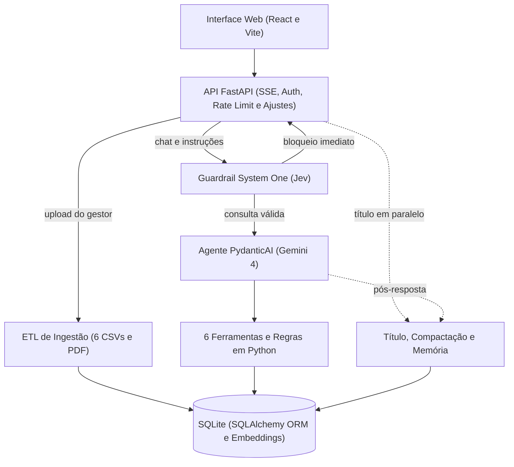

# Empório da Música

Assistente de atendimento ao cliente em Python para a loja fictícia Empório da Música, em Campo Grande, MS. O projeto separa dados operacionais de texto livre desde a ingestão. Catálogo, promoções, clientes e pedidos ficam em SQLite acessado via SQLAlchemy ORM para consulta exata. O manual de políticas em PDF usa embeddings do Gemini e busca vetorial por similaridade de cosseno.

Feito por Diogo de Souza em [diogo.sh](https://diogo.sh).

## Demo online

A aplicação está publicada em [artefact.diogo.sh](https://artefact.diogo.sh) com a base da loja e os embeddings do manual já carregados. O frontend roda no AWS Amplify e a API roda em uma instância EC2 `t4g.small` em `sa-east-1` atrás de Caddy com HTTPS automático, carregando segredos direto em memória via AWS Secrets Manager (sem `.env` em disco) e sem porta SSH exposta.

Todas as contas pré-cadastradas na demo online usam a senha `Artefact#123`.

| Perfil | E-mail | Cenário pronto para testar |
| --- | --- | --- |
| Gestor | `admin@admin.com` | Troca de modelo Gemini 4, toggle de ferramentas, upload da base e trace do guardrail Jev |
| Cliente | `isabela.moreira@jmail.com` | Pedido `#3` entregue em 05/12/2025 (fora dos 7 dias), bloqueio anti-IDOR ao consultar pedido `#7` e compra pelo chat |
| Cliente | `leticia.rocha@jmail.com` | Pedido `#7` entregue em 17/02/2026 (Shelby SU-21S), consulta autenticada sem pedir segundo fator |
| Cliente | `bruno.martins@jmail.com` | E-mail compartilhado por dois cadastros, acionando step-up por telefone `(67) 98543-2109` no pedido `#10` |

## Como rodar localmente

O projeto exige Python 3.12 ou superior, [uv](https://docs.astral.sh/uv/) e Node.js 20 ou superior.

1. Instale as dependências do backend e crie o arquivo de ambiente.

```bash
uv sync
cp .env.example .env
```

2. Preencha `GEMINI_API_KEY` no arquivo `.env` (e opcionalmente `TYPESAFE_API_KEY` para ativar o guardrail de entrada com Jev) e inicie a API em FastAPI.

```bash
uv run uvicorn emporio.api:create_app --factory --host 127.0.0.1 --port 8000
```

3. Em outro terminal, instale as dependências da interface web e inicie o Vite.

```bash
cd web
npm install
npm run dev
```

4. Acesse `http://127.0.0.1:5173`.

### Perfis de acesso e carga inicial

O banco SQLite começa vazio na primeira execução e cria as contas iniciais configuráveis pelo `.env`. Assim que o gestor envia os CSVs da loja (ou ao iniciar sobre uma base já carregada), o seed cria automaticamente uma conta de cliente para cada e-mail único de `customers.csv` (49 contas, como `isabela.moreira@jmail.com`, `leticia.rocha@jmail.com` e `bruno.martins@jmail.com`) usando `SEED_USER_PASSWORD` (`user123` localmente), preservando contas já cadastradas.

- Gestor (`admin@admin.com` e senha `admin123` localmente). Acessa o chat de teste e a tela **Ajustes**, onde envia os arquivos da loja, escolhe qual modelo Gemini 4 responde no atendimento e liga ou desliga cada ferramenta do agente.
- Cliente (`user@user.com` ou qualquer cliente de `customers.csv` com senha `user123` localmente). Acessa o chat, pedidos por chat com card de confirmação, a aba **Personalização** (instruções de estilo validadas por guardrail e memórias da conta) e o modal **Sobre a loja**. Clientes autenticados em um cadastro da loja podem consultar seus próprios pedidos e elegibilidade de devolução diretamente, mantendo bloqueio contra pedidos de terceiros e desambiguação para e-mails compartilhados. Qualquer pessoa também pode criar uma conta nova em **Criar conta**, sem confirmação por e-mail.

Antes de subir em produção, altere `SEED_ADMIN_EMAIL`, `SEED_ADMIN_PASSWORD`, `SEED_USER_EMAIL`, `SEED_USER_PASSWORD` e `AUTH_SECRET` no `.env` ou no gerenciador de segredos.

Para carregar a base da loja localmente, entre como gestor, abra **Ajustes** e envie os arquivos originais de [`data/raw/`](data/raw/).

- Em **Base operacional (CSVs)**, envie os seis arquivos CSV de uma vez ou um `.zip` contendo os seis arquivos.
- Em **Manual de políticas (PDF)**, envie [`políticas_da_loja.pdf`](data/raw/pol%C3%ADticas_da_loja.pdf).

Enquanto os dois envios não forem concluídos, contas de cliente veem apenas a tela **Atendimento indisponível** com telefone e e-mail da equipe, sem expor detalhes internos da base.

### Testes e verificação

Execute os testes automatizados, o linter e o build do frontend a partir da raiz do repositório.

```bash
uv run pytest -v
uv run ruff check src tests
cd web && npm run build
```

## Arquitetura

O fluxo abaixo resume a separação entre interface, rate limit, validação de entrada, raciocínio do agente, tarefas auxiliares e persistência local.



## Decisões técnicas

- **Ingestão em dois slots independentes.** A base começa vazia e recebe os seis CSVs em `ingest_store_csvs` e o PDF em `ingest_policy_pdf`. Reenviar um conjunto não apaga o outro nem as conversas salvas. Os arquivos originais ficam intactos em [`data/raw/`](data/raw/).
- **Sanitização auditável da base.** A auditoria completa das 11 anomalias encontradas nos CSVs e no PDF está documentada em [`docs/data_audit.md`](docs/data_audit.md). Os CSVs brutos contêm seis produtos com marca ou ficha técnica trocada na descrição (`135`, `137`, `139`, `140`, `142` e `144`), um produto descontinuado com estoque fantasma 13 (`136`), um pré-lançamento presente em pedidos antigos (`130`), um item ativo sem estoque (`96`) e um e-mail repetido entre os clientes `11` e `43`. O PDF lista dois telefones diferentes, `(67) 3341-4444` e `(67) 3321-4500`, e um e-mail com acento inválido. O ETL prioriza nome e `specs`, zera o estoque descontinuado, mantém itens históricos como não vendáveis e registra cada ajuste na tabela `etl_audit_log`.
- **ORM no catálogo e busca vetorial no manual.** Preço, estoque e pedidos saem de consultas tipadas no SQLAlchemy sobre SQLite, eliminando alucinação em filtros numéricos e datas. O manual em PDF é dividido em 26 trechos por seção e subseção, recebe embeddings `gemini-embedding-001` na ingestão e usa similaridade de cosseno na busca, com fallback por palavras em Python se a API falhar.
- **Framework PydanticAI e escolha do modelo padrão.** PydanticAI foi escolhido por oferecer contratos tipados em Python, streaming granular de pensamento e chamadas de ferramenta via `agent.iter` e hooks dinâmicos de schema por sessão (`prepare`) sem abstrações opacas de grafo. O modelo padrão `google:gemini-4-hydrogen` (com `thinking="low"`) equilibra baixa latência e precisão rigorosa no uso de ferramentas no atendimento diário. Apenas o gestor pode alternar em tempo real entre os quatro modelos Gemini 4 (`gemini-4-hydrogen`, `gemini-4-neon`, `gemini-4-carbon` e `gemini-4-argon`) e desativar qualquer uma das seis ferramentas para testar limites de resposta sem invenção de dados.
- **Estratégia de prompt enxuta com regras determinísticas fora do prompt.** O prompt em `build_system_prompt` contém nove diretrizes curtas de tom, escopo, privacidade e formatação, sem embutir tabelas nem cálculos manuais. O cálculo de 5% no PIX não cumulativo com promoções, os valores mínimos de parcela em até 12x sem juros, o frete para Campo Grande e outras cidades e o prazo legal de 7 dias para devolução rodam em Python determinístico em [`src/emporio/domain/rules.py`](src/emporio/domain/rules.py). A regra 6 se adapta dinamicamente ao canal (sessão web autenticada versus 2FA estrito em canais sem login), e preferências/memórias do usuário entram em bloco isolado com instrução explícita de nunca sobrepor políticas da loja.
- **Gateways de segurança LGPD e pedidos por chat.** Em [`src/emporio/agent/tools.py`](src/emporio/agent/tools.py), `lookup_order` aplica gateways de segurança em camada de servidor sobre a identidade autenticada via token HMAC, impedindo acesso cruzado a pedidos de terceiros (anti-IDOR), exigindo step-up por telefone quando o e-mail pertence a mais de um cadastro (`bruno.martins@jmail.com`), bloqueando a conversa após cinco tentativas falhas (anti-enumeração) e mantendo 2FA estrito em canais não autenticados ou no modo gestor. Para compras pelo chat, `prepare_order_draft` gera um card separado de confirmação (human-in-the-loop) com preço, estoque, parcelamento e frete validados em Python. Só ao clicar em **Confirmar pedido** (`POST /api/orders/drafts/{draft_id}/confirm`) o pedido é gravado no banco com baixa de estoque e código de rastreio. Para fins de teste, o pedido confirmado é marcado automaticamente como entregue após 5 minutos com mensagem de notificação no chat, permitindo testar imediatamente a devolução dentro do prazo legal de 7 dias.
- **Guardrail de entrada System One com Jev.** Inspirado na divisão rápido e devagar documentada em [diogo.sh/system-one](https://diogo.sh/system-one/), [`src/emporio/agent/guardrails.py`](src/emporio/agent/guardrails.py) consulta o Jev (`POST https://api.typesafe.ai/v1/systemone`) antes de chamar o Gemini 4. Com probabilidades calibradas (`noul` para prompt injection com limiar `0.85` e `choice` para intenção com limiar `0.90`), tentativas de injeção, assuntos fora de tema e pedidos exclusivos de acessórios recebem resposta imediata em cerca de 240 a 320 ms sem gastar tokens do modelo principal. Consultas legítimas seguem para o agente com a etapa do guardrail visível apenas para o perfil gestor, e qualquer erro de rede faz fail-open para não interromper o atendimento.
- **Compactação de conversa, memória e personalização por usuário.** [`src/emporio/agent/memory.py`](src/emporio/agent/memory.py) mantém os últimos turnos intactos e compacta mensagens antigas em `session_summaries` quando a conversa cresce, preservando preferências e restrições sem apagar o histórico completo da interface. Em paralelo após a resposta, extrai apenas preferências duráveis e não sensíveis do usuário em `user_memories`, com filtro determinístico em Python contra PII. Na aba **Personalização**, qualquer usuário autenticado pode revisar ou apagar suas memórias e definir instruções gerais de tom e formato (`GET` e `PUT /api/personalization`), validadas por regras determinísticas e pelo guardrail Jev contra injeção persistida antes de salvar.
- **Rate limit por usuário e por IP.** Em [`src/emporio/api/rate_limit.py`](src/emporio/api/rate_limit.py), um limitador sliding-window protege `POST /api/chat` por usuário (`RATE_LIMIT_CHAT_PER_MINUTE=20`) e `/api/auth/login` e `/api/auth/register` por IP (`RATE_LIMIT_AUTH_PER_MINUTE=15`), retornando HTTP `429` com cabeçalho `Retry-After` para evitar abuso e proteger a cota da API na demo pública.
- **Núcleo desacoplado de canal.** O agente depende apenas dos contratos em [`src/emporio/ports.py`](src/emporio/ports.py). A API FastAPI e o frontend React atuam como um adaptador fino de entrada e saída, o que permite adicionar ou remover canais como WhatsApp sem reescrever o núcleo.

## Exemplos de interação

A pasta [`examples/`](examples/) traz cinco transcrições reais executadas com `google:gemini-4-hydrogen`, embeddings `gemini-embedding-001` e guardrail Jev sobre a base completa da loja, incluindo o trace real das ferramentas.

1. [`01_catalogo_e_disponibilidade.md`](examples/01_catalogo_e_disponibilidade.md) Filtro de violões até R$ 1.000 sem itens indisponíveis, bloqueio do estoque fantasma do Ibanez Bass 2X (`136`) e ficha curada do Music Man Bass 1X (`135`).
2. [`02_preco_pix_e_promocoes.md`](examples/02_preco_pix_e_promocoes.md) Transparência na promoção expirada do Takamine GD20, cálculo de PIX e 12x, não cumulatividade de PIX na promoção ativa de 18% do Crafter HT-100 e frete Campo Grande versus Dourados.
3. [`03_devolucao_lgpd_e_gateways.md`](examples/03_devolucao_lgpd_e_gateways.md) Validação de titularidade e prazo de 7 dias nos pedidos `#3` (fora do prazo) e `#7` (elegível), bloqueio anti-IDOR entre contas, step-up por telefone para o e-mail duplicado `bruno.martins@jmail.com` no pedido `#10` e 2FA estrito em canal sem login.
4. [`04_pedido_no_chat_e_entrega.md`](examples/04_pedido_no_chat_e_entrega.md) Compra pelo chat com card de confirmação human-in-the-loop, baixa de estoque, entrega simulada automática após 5 minutos e validação imediata de devolução dentro dos 7 dias corridos.
5. [`05_fora_de_escopo_e_guardrail_jev.md`](examples/05_fora_de_escopo_e_guardrail_jev.md) Bloqueio em System One (Jev) para acessórios, assuntos fora de tema e tentativa de prompt injection sem consumir tokens do Gemini 4.

## Evals

O projeto inclui uma suíte de avaliação em três camadas baseada em [diogo.sh/evals](https://diogo.sh/evals), detalhada em [`evals/README.md`](evals/README.md).

- **Camada determinística sobre o trace.** [`evals/dataset.jsonl`](evals/dataset.jsonl) reúne 18 casos em nove categorias de falha (catálogo curado, disponibilidade, matemática de PIX e frete, recusa de acessórios, LGPD em dois fatores, busca vetorial no manual, ferramenta desativada, isolamento entre perfis e segurança do guardrail Jev). Os avaliadores checam chamadas e argumentos reais no trace além do texto final.
- **Rótulos humanos e calibração do juiz-LLM.** [`evals/human_labels.jsonl`](evals/human_labels.jsonl) contém 14 exemplos rotulados manualmente (`7 PASS` reais e `7 FAIL` da taxonomia). Na calibração com `google:gemini-4-hydrogen`, o juiz binário atingiu 100,0% de concordância, TPR de 100,0%, TNR de 100,0% e kappa de Cohen `1.000`.

```bash
uv run python -m emporio.evals --model google:gemini-4-hydrogen
uv run python -m emporio.evals --validate-judge --model google:gemini-4-hydrogen
uv run python -m emporio.evals --model google:gemini-4-hydrogen --with-judge
```

## Limitações e próximos passos

- **Observabilidade em produção.** Hoje os traces por mensagem e o histórico de auditoria do ETL ficam persistidos no SQLite para inspeção local e evals. Como próxima etapa para operação em larga escala, entrariam logs estruturados por turno sem PII, medição contínua de latência (`p50`/`p95`), consumo de tokens e taxa de bloqueio do guardrail exportados via OpenTelemetry para um coletor dedicado.
- **Escala vetorial.** Guardar embeddings no SQLite funciona bem para poucos documentos e evita subir um serviço adicional. Para grandes volumes de texto, o mesmo contrato de busca migraria para um banco vetorial dedicado.
- **Expansão dos evals em produção.** A suíte atual cobre 56 testes unitários e de API mais 18 cenários de eval calibrados com 14 rótulos humanos. Em operação real, novos traces rotulados por humanos alimentariam continuamente a taxonomia e comparariam diferentes modelos Gemini 4 em latência e custo.
- **Autenticação e rate limit distribuído.** O login usa hash `scrypt`, token assinado com HMAC e rate limit em memória para um processo único do Uvicorn. Em escala horizontal com múltiplas réplicas, entrariam verificação de e-mail, revogação de sessão e contadores compartilhados em Redis.
- **Novos canais.** A interface web cobre o fluxo completo de cliente e gestor. Integrar WhatsApp ou Telegram exigiria apenas um novo adaptador sobre `ConversationService`, herdando automaticamente o gateway de verificação em 2 fatores (`order_id` + e-mail ou telefone) para sessões sem login.

## Uso de assistentes de IA

Conduzi diretamente a arquitetura, os cortes de escopo, a auditoria da base, os gateways de segurança, a taxonomia e a rotulagem dos evals. Assistentes de IA apoiaram o trabalho operacional (boilerplate, implementação incremental, testes e scripts de deploy), com revisão manual de cada commit.
